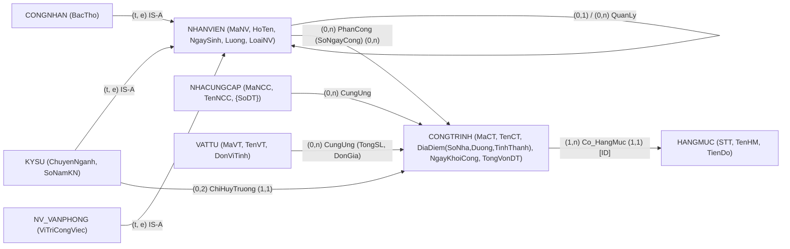

# Lời Giải Chi Tiết: `03. Đê Ôn Tập -CSDL NC.pdf`

> Môn: Cơ sở dữ liệu nâng cao — Khoa CNTT, ĐH Sài Gòn (Khóa 24, 120 phút).

---

## Câu I (2,0 điểm): Transaction & Kiến trúc HQT CSDL

### a) (1,0 đ) Bốn tính chất ACID của Transaction và thành phần HQT CSDL bảo đảm
1. **Atomicity (Tính nguyên tố / Toàn vẹn thao tác):**
   - *Ý nghĩa:* Giao dịch (transaction) là một đơn vị công việc không thể chia cắt; hoặc thực hiện thành công **toàn bộ**, hoặc **hủy bỏ (rollback) toàn bộ** nếu có lỗi xảy ra.
   - *Thành phần bảo đảm:* **Transaction Manager** kết hợp **Recovery Manager (Bộ quản lý phục hồi)** (sử dụng Undo log).
2. **Consistency (Tính nhất quán):**
   - *Ý nghĩa:* Giao dịch phải đưa CSDL từ một trạng thái hợp lệ này sang một trạng thái hợp lệ khác, thỏa mãn mọi ràng buộc toàn vẹn (khóa, miền giá trị, quy tắc nghiệp vụ...).
   - *Thành phần bảo đảm:* **Transaction Manager / Integrity Constraint Checker (Bộ kiểm tra ràng buộc toàn vẹn)** kết hợp với logic ứng dụng / trigger / constraint của HQT CSDL.
3. **Isolation (Tính cô lập):**
   - *Ý nghĩa:* Các giao dịch thực thi đồng thời không được can thiệp làm sai lệch dữ liệu của nhau; kết quả tương đương với việc thực thi tuần tự.
   - *Thành phần bảo đảm:* **Concurrency Control Manager (Bộ điều khiển đồng thời)** (sử dụng khóa - Locking, Timestamp, hoặc MVCC).
4. **Durability (Tính bền vững):**
   - *Ý nghĩa:* Khi giao dịch đã **commit** thành công, mọi thay đổi dữ liệu được lưu trữ vĩnh viễn và không bị mất ngay cả khi hệ thống gặp sự cố (mất điện, crash).
   - *Thành phần bảo đảm:* **Recovery Manager (Bộ quản lý phục hồi)** kết hợp **Buffer Manager** (sử dụng Redo log / Write-Ahead Logging - WAL).

### b) (1,0 đ) Các nhóm ngôn ngữ CSDL & 3 nhiệm vụ chính của DBA
- **Các nhóm ngôn ngữ CSDL:**
  1. **DDL (Data Definition Language – Ngôn ngữ định nghĩa dữ liệu):** Định nghĩa, sửa đổi, xóa cấu trúc CSDL (bảng, khung nhìn, chỉ mục, ràng buộc).
     - *Ví dụ:* `CREATE TABLE SINHVIEN (MaSV VARCHAR(10) PRIMARY KEY, HoTen NVARCHAR(50));`
  2. **DML (Data Manipulation Language – Ngôn ngữ thao tác dữ liệu):** Truy vấn và cập nhật dữ liệu trong các bảng (thêm, sửa, xóa, đọc).
     - *Ví dụ:* `INSERT INTO SINHVIEN VALUES ('SV01', N'Nguyễn Văn A');` (hoặc `SELECT * FROM SINHVIEN;`)
  3. **DCL (Data Control Language – Ngôn ngữ điều khiển dữ liệu):** Cấp phát và thu hồi quyền truy cập CSDL.
     - *Ví dụ:* `GRANT SELECT, INSERT ON SINHVIEN TO user_sv;`
- **Ba nhiệm vụ chính của người quản trị CSDL (DBA):**
  1. Thiết kế, cài đặt và bảo trì cấu trúc CSDL (lược đồ, phân vùng, chỉ mục).
  2. Quản lý bảo mật, phân quyền người dùng và bảo đảm toàn vẹn dữ liệu.
  3. Sao lưu (backup), phục hồi (recovery) khi có sự cố và giám sát, tối ưu hiệu năng hệ thống.

---

## Câu II (3,0 điểm): Sơ đồ EER & Chuyển sang Lược đồ Quan hệ

### a) (2,0 đ) Mô hình EER (ký hiệu bản số `(min, max)`, khóa, loại thuộc tính, ràng buộc chuyên biệt hóa)

#### 1. Các thực thể & thuộc tính
- **`NHANVIEN`**: **<u>`MaNV`</u>** (khóa), `HoTen`, `NgaySinh`, `Luong`, `LoaiNV`.
  - Chuyên biệt hóa **toàn phần, riêng biệt `(t, e)`** dựa trên `LoaiNV` thành 3 thực thể con:
    - **`KYSU`**: `ChuyenNganh`, `SoNamKN`
    - **`CONGNHAN`**: `BacTho`
    - **`NV_VANPHONG`**: `ViTriCongViec`
- **`CONGTRINH`**: **<u>`MaCT`</u>** (khóa), `TenCT`, thuộc tính đa hợp **`DiaDiem`**(`SoNha`, `Duong`, `TinhThanh`), `NgayKhoiCong`, `TongVonDT`.
- **`HANGMUC`** *(thực thể yếu — định danh phối hợp với `CONGTRINH`)*: **<u>`STT`</u>** (khóa bộ phận/định danh riêng trong từng công trình), `TenHM`, `TienDo`.
- **`NHACUNGCAP`**: **<u>`MaNCC`</u>** (khóa), `TenNCC`, thuộc tính đa trị **`{SoDT}`** với bản số `(0,n)`.
- **`VATTU`**: **<u>`MaVT`</u>** (khóa), `TenVT`, `DonViTinh`.

#### 2. Các mối kết hợp & bản số `(min, max)`
- **`QuanLy`** *(phản thân trên `NHANVIEN`)*:
  - Vai trò *Được quản lý*: `(0,1)` — mỗi nhân viên chịu sự quản lý của nhiều nhất 1 nhân viên khác.
  - Vai trò *Quản lý*: `(0,n)` — một nhân viên có thể quản lý nhiều nhân viên.
- **`ChiHuyTruong`** giữa `KYSU` và `CONGTRINH`:
  - `KYSU` — `(0,2)` — `ChiHuyTruong` — `(1,1)` — `CONGTRINH` (mỗi công trình có đúng 1 kỹ sư chỉ huy trưởng; mỗi kỹ sư làm chỉ huy trưởng nhiều nhất 2 công trình).
- **`Co_HangMuc`** *(mối kết hợp định danh giữa `CONGTRINH` và `HANGMUC`)*:
  - `CONGTRINH` — `(1,n)` — `Co_HangMuc` — `(1,1)` — `HANGMUC` (mỗi công trình gồm ít nhất 1 hạng mục; mỗi hạng mục thuộc đúng 1 công trình và định danh bởi `{CONGTRINH, STT}`).
- **`PhanCong`** giữa `NHANVIEN` và `CONGTRINH` (thuộc tính: `SoNgayCong`):
  - `NHANVIEN` — `(0,n)` — `PhanCong` — `(0,n)` — `CONGTRINH`.
- **`CungUng`** *(mối kết hợp 3 ngôi)* giữa `NHACUNGCAP`, `VATTU`, `CONGTRINH` (thuộc tính: `TongSoLuong`, `DonGiaThoaThuan`):
  - `NHACUNGCAP`: `(0,n)`, `VATTU`: `(0,n)`, `CONGTRINH`: `(0,n)`.



#### 3. Giải thích vì sao KHÔNG thể thay mối kết hợp 3 ngôi `CungUng` bằng 3 mối kết hợp 2 ngôi
Nếu tách `CungUng(NCC, VT, CT)` thành 3 mối kết hợp 2 ngôi `(NCC - VT)`, `(VT - CT)`, `(NCC - CT)`:
1. **Mất ngữ nghĩa liên kết đồng thời (Semantic loss / Connection trap):** Ta chỉ biết *NCC A có cung ứng VT X*, *VT X có dùng cho CT Y*, *NCC A có làm việc với CT Y*, nhưng **không biết chắc NCC A có trực tiếp cung ứng VT X cho CT Y hay không** (có thể NCC B mới là bên cung ứng VT X cho CT Y, còn NCC A cung ứng VT Z cho CT Y).
2. **Không lưu được thuộc tính của bộ ba:** `TongSoLuong` và `DonGiaThoaThuan` phụ thuộc đồng thời vào cả `(MaNCC, MaVT, MaCT)`, không thể gắn vào bất kỳ cặp 2 ngôi nào.

---

### b) (1,0 đ) Chuyển sơ đồ EER sang Lược đồ CSDL Quan hệ
*(Chọn phương án tách bảng chuyên biệt kết hợp bảng cha cho `(t, e)`, tách thuộc tính đa trị `SoDT`, làm phẳng thuộc tính đa hợp `DiaDiem`, kéo khóa `MaCT` xuống thực thể yếu `HANGMUC`)*

1. **`NHANVIEN`**(**<u>`MaNV`</u>**, `HoTen`, `NgaySinh`, `Luong`, `LoaiNV`, *`MaNV_QL`*)
   - FK: `MaNV_QL` → `NHANVIEN(MaNV)`
2. **`KYSU`**(**<u>`MaNV`</u>**, `ChuyenNganh`, `SoNamKN`)
   - FK: `MaNV` → `NHANVIEN(MaNV)`
3. **`CONGNHAN`**(**<u>`MaNV`</u>**, `BacTho`)
   - FK: `MaNV` → `NHANVIEN(MaNV)`
4. **`NV_VANPHONG`**(**<u>`MaNV`</u>**, `ViTriCongViec`)
   - FK: `MaNV` → `NHANVIEN(MaNV)`
5. **`CONGTRINH`**(**<u>`MaCT`</u>**, `TenCT`, `SoNha`, `Duong`, `TinhThanh`, `NgayKhoiCong`, `TongVonDT`, *`MaKS_ChiHuy`*)
   - FK: `MaKS_ChiHuy` → `KYSU(MaNV)` (NOT NULL)
6. **`HANGMUC`**(**<u>`MaCT`, `STT`</u>**, `TenHM`, `TienDo`)
   - FK: `MaCT` → `CONGTRINH(MaCT)`
7. **`PHANCONG`**(**<u>`MaNV`, `MaCT`</u>**, `SoNgayCong`)
   - FK: `MaNV` → `NHANVIEN(MaNV)`, `MaCT` → `CONGTRINH(MaCT)`
8. **`NHACUNGCAP`**(**<u>`MaNCC`</u>**, `TenNCC`)
9. **`NCC_SODT`**(**<u>`MaNCC`, `SoDT`</u>**)
   - FK: `MaNCC` → `NHACUNGCAP(MaNCC)`
10. **`VATTU`**(**<u>`MaVT`</u>**, `TenVT`, `DonViTinh`)
11. **`CUNGUNG`**(**<u>`MaNCC`, `MaVT`, `MaCT`</u>**, `TongSoLuong`, `DonGiaThoaThuan`)
    - FK: `MaNCC` → `NHACUNGCAP(MaNCC)`, `MaVT` → `VATTU(MaVT)`, `MaCT` → `CONGTRINH(MaCT)`

---

## Câu III (2,5 điểm): Phụ thuộc hàm, Khóa, Phủ tối tiểu, Dạng chuẩn & Chase

### a) (0,5 đ) Chứng minh & Bác bỏ
- **Chứng minh luật tựa bắc cầu:** Nếu $X \to Y$ và $WY \to Z$ thì $WX \to Z$.
  1. Từ $X \to Y$, áp dụng **luật tăng trưởng** với $W$: $WX \to WY$.
  2. Kết hợp $WX \to WY$ và $WY \to Z$, áp dụng **luật bắc cầu**: $WX \to Z$. (ĐPCM)
- **Bác bỏ khẳng định:** *"Nếu $XY \to Z$ thì $X \to Z$"*.
  - Xét thể hiện quan hệ $r(X, Y, Z)$:

| $X$ | $Y$ | $Z$ |
|---|---|---|
| 1 | 1 | 1 |
| 1 | 2 | 2 |

  - Cặp $(X, Y)$ ở 2 bộ là $(1,1) \neq (1,2)$ nên $r$ **thỏa** $XY \to Z$.
  - Hai bộ có cùng $X = 1$ nhưng $Z$ khác nhau ($1 \neq 2$) nên $r$ **vi phạm** $X \to Z$. Vậy khẳng định sai.

---

Xét $R(A, B, C, D, E, G)$ và $F = \{ A \to C,\ C \to A,\ B \to AC,\ ACD \to B,\ CD \to E,\ E \to G \}$.

### b) (0,5 đ) Tìm tất cả các khóa của $R$
- Tập nguồn $TN = \{D\}$ (chỉ có ở vế trái).
- Tập trung gian $TG = \{A, B, C, E\}$ (xuất hiện ở cả 2 vế; $G$ chỉ ở vế phải nên không nằm trong $TN$ hay $TG$).
- Xét $TN \cup X_i$ với $X_i \subseteq TG$:
  - $(D)^+ = D \neq U$
  - $(DA)^+ = DACBEG = U \Rightarrow$ **`AD` là khóa**.
  - $(DB)^+ = DBACEG = U \Rightarrow$ **`BD` là khóa**.
  - $(DC)^+ = DCABEG = U \Rightarrow$ **`CD` là khóa**.
  - $(DE)^+ = DEG \neq U$.
  - Mọi tập lớn hơn chứa $A, B,$ hoặc $C$ đều chứa siêu khóa $AD, BD,$ hoặc $CD$ nên không tối thiểu.
- **Kết luận:** $R$ có 3 khóa: **`AD`, `BD`, `CD`**.

### c) (0,5 đ) Tìm một phủ tối tiểu của $F$
1. **Loại bỏ thuộc tính dư thừa ở vế trái:**
   - Xét $ACD \to B$: thử bỏ $A$, tính $(CD)^+$: $C \to A \Rightarrow CDA$, rồi $ACD \to B \Rightarrow CDAB$. Vì $(CD)^+$ chứa $A$ (và $B$) nên **$A$ dư thừa** $\Rightarrow$ thay bằng $CD \to B$.
   - Với $CD \to B$ và $CD \to E$: $(D)^+ = D$, $(C)^+ = CA \Rightarrow$ không bỏ được $C$ hay $D$.
2. **Tách vế phải thành 1 thuộc tính:**
   - $B \to AC$ tách thành $B \to A$ và $B \to C$.
   - Tập tạm: $\{ A \to C,\ C \to A,\ B \to A,\ B \to C,\ CD \to B,\ CD \to E,\ E \to G \}$.
3. **Loại bỏ PTH dư thừa:**
   - Xét $B \to A$: nếu bỏ đi, từ $B \to C$ và $C \to A$ vẫn suy ra $B \to A$ ($(B)^+ = BCA$) $\Rightarrow$ **$B \to A$ dư thừa, loại bỏ**.
   - Kiểm tra các PTH còn lại: không PTH nào suy diễn được từ các PTH khác.
- **Phủ tối tiểu:** $F_{\text{tt}} = \{ A \to C,\ C \to A,\ B \to C,\ CD \to B,\ CD \to E,\ E \to G \}$.

### d) (0,25 đ) Dạng chuẩn cao nhất của $R$
- Thuộc tính khóa: $\{A, B, C, D\}$. Thuộc tính không khóa: $\{E, G\}$.
- **Kiểm tra 2NF:** Các tập con thật sự của mọi khóa ($A, B, C, D$) có bao đóng $A^+=AC, B^+=BAC, C^+=CA, D^+=D$ — không chứa thuộc tính không khóa nào $\Rightarrow$ **đạt 2NF**.
- **Kiểm tra 3NF:** Xét $E \to G$ ($G \notin E$): $E$ **không phải siêu khóa** ($E^+ = EG \neq U$) và $G$ **không phải thuộc tính khóa** (vi phạm 3NF do phụ thuộc bắc cầu $CD \to E \to G$).
- **Kết luận:** $R$ đạt dạng chuẩn cao nhất là **2NF**.

### e) (0,75 đ) Kiểm tra phân rã $\rho = \{ R_1(A, C),\ R_2(B, C, D),\ R_3(D, E, G) \}$
1. **Kiểm tra kết nối không mất thông tin (Phương pháp bảng Chase):**

| Quan hệ | $A$ | $B$ | $C$ | $D$ | $E$ | $G$ |
|---|---|---|---|---|---|---|
| $R_1(A,C)$ | $a_1$ | $b_{12}$ | $a_3$ | $b_{14}$ | $b_{15}$ | $b_{16}$ |
| $R_2(B,C,D)$ | $b_{21} \to \mathbf{a_1}$ | $a_2$ | $a_3$ | $a_4$ | $b_{25}$ | $b_{26}$ |
| $R_3(D,E,G)$ | $b_{31}$ | $b_{32}$ | $b_{33}$ | $a_4$ | $a_5$ | $a_6$ |

- Áp dụng $C \to A$: $R_1, R_2$ cùng có $a_3$ ở $C \Rightarrow b_{21}$ đổi thành $a_1$.
- Không còn cặp dòng nào trùng vế trái của bất kỳ PTH nào trong $F$ để đồng nhất tiếp. Bảng dừng lại mà **không có dòng nào toàn $a$**.
- $\Rightarrow$ $\rho$ **KHÔNG kết nối không mất thông tin**.

2. **Kiểm tra bảo toàn phụ thuộc hàm:**
- Chiếu $F$ lên các $R_i$: $F_{R_1} = \{A \to C, C \to A\}$, $F_{R_2} = \{B \to C, CD \to B\}$, $F_{R_3} = \{E \to G\}$.
- Hợp $F_\rho = \{A \to C, C \to A, B \to C, CD \to B, E \to G\}$.
- Tính $(CD)^+_{F_\rho} = \{C, D, B, A\}$ không chứa $E \Rightarrow$ mất PTH $CD \to E$.
- $\Rightarrow$ $\rho$ **KHÔNG bảo toàn phụ thuộc hàm**.

3. **Đề xuất phép phân rã mới đạt 3NF, kết nối không mất thông tin và bảo toàn PTH:**
- Tổng hợp từ $F_{\text{tt}} = \{ A \to C,\ C \to A,\ B \to C,\ CD \to B,\ CD \to E,\ E \to G \}$:
  - $\rho' = \{ R_1(A, C),\ R_2(B, C, D, E),\ R_3(E, G) \}$
  - Mọi $R_i$ đều đạt 3NF; chứa toàn bộ PTH trong $F_{\text{tt}}$ (bảo toàn PTH); $R_2$ chứa khóa $CD$ của $R$ (kết nối không mất thông tin).

---

## Câu IV (2,5 điểm): SQL Server (T-SQL)

### a) (0,5 đ) Tạo bảng `HOADON` và `CTHD`
```sql
CREATE TABLE HOADON (
    SoHD    VARCHAR(20) PRIMARY KEY,
    NgayHD  DATE        NOT NULL DEFAULT GETDATE(),
    MaKH    VARCHAR(20) NOT NULL,
    TriGia  DECIMAL(18, 2) NOT NULL DEFAULT 0,
    CONSTRAINT FK_HOADON_KHACHHANG FOREIGN KEY (MaKH)
        REFERENCES KHACHHANG(MaKH)
        ON DELETE NO ACTION
);

CREATE TABLE CTHD (
    SoHD    VARCHAR(20) NOT NULL,
    MaSP    VARCHAR(20) NOT NULL,
    SoLuong INT         NOT NULL CHECK (SoLuong > 0),
    DonGia  DECIMAL(18, 2) NOT NULL CHECK (DonGia >= 0),
    CONSTRAINT PK_CTHD PRIMARY KEY (SoHD, MaSP),
    CONSTRAINT FK_CTHD_HOADON FOREIGN KEY (SoHD)
        REFERENCES HOADON(SoHD)
        ON DELETE CASCADE,
    CONSTRAINT FK_CTHD_SANPHAM FOREIGN KEY (MaSP)
        REFERENCES SANPHAM(MaSP)
        ON DELETE NO ACTION
);
```

### b) (0,5 đ) Thống kê khách hàng ở "TP.HCM" năm 2025
```sql
SELECT
    kh.MaKH,
    kh.HoTen,
    COUNT(hd.SoHD) AS SoHoaDon,
    COALESCE(SUM(hd.TriGia), 0) AS TongTriGia
FROM KHACHHANG kh
LEFT JOIN HOADON hd
    ON kh.MaKH = hd.MaKH
    AND YEAR(hd.NgayHD) = 2025
WHERE kh.ThanhPho = N'TP.HCM'
GROUP BY kh.MaKH, kh.HoTen;
```
> *Lưu ý:* Điều kiện `YEAR(hd.NgayHD) = 2025` phải đặt trong `ON` (không đặt trong `WHERE`) để không làm mất các khách hàng chưa mua hàng trong năm 2025.

### c) (0,75 đ) Top 2 sản phẩm bán chạy nhất mỗi loại (lấy cả đồng hạng)
```sql
WITH ThongKeBan AS (
    SELECT
        sp.LoaiSP,
        sp.MaSP,
        sp.TenSP,
        COALESCE(SUM(ct.SoLuong), 0) AS TongSL,
        DENSE_RANK() OVER (
            PARTITION BY sp.LoaiSP
            ORDER BY COALESCE(SUM(ct.SoLuong), 0) DESC
        ) AS Hang
    FROM SANPHAM sp
    LEFT JOIN CTHD ct ON sp.MaSP = ct.MaSP
    GROUP BY sp.LoaiSP, sp.MaSP, sp.TenSP
)
SELECT LoaiSP, MaSP, TenSP, TongSL
FROM ThongKeBan
WHERE Hang <= 2
ORDER BY LoaiSP, TongSL DESC;
```

### d) (0,75 đ) Thủ tục `sp_BanHang(@SoHD, @MaSP, @SoLuong)`
```sql
CREATE PROCEDURE sp_BanHang
    @SoHD    VARCHAR(20),
    @MaSP    VARCHAR(20),
    @SoLuong INT
AS
BEGIN
    SET NOCOUNT ON;
    SET XACT_ABORT ON;

    IF @SoLuong IS NULL OR @SoLuong <= 0
    BEGIN
        RAISERROR(N'Số lượng bán phải lớn hơn 0.', 16, 1);
        RETURN;
    END

    BEGIN TRY
        BEGIN TRANSACTION;

        -- Kiểm tra hóa đơn tồn tại
        IF NOT EXISTS (SELECT 1 FROM HOADON WHERE SoHD = @SoHD)
            THROW 50001, N'Hóa đơn không tồn tại.', 1;

        -- Lấy đơn giá & tồn kho hiện hành (khóa cập nhật để tránh race condition)
        DECLARE @DonGia DECIMAL(18, 2), @SoLuongTon INT;
        SELECT @DonGia = DonGia, @SoLuongTon = SoLuongTon
        FROM SANPHAM WITH (UPDLOCK, ROWLOCK)
        WHERE MaSP = @MaSP;

        IF @DonGia IS NULL
            THROW 50002, N'Sản phẩm không tồn tại.', 1;

        IF @SoLuongTon < @SoLuong
            THROW 50003, N'Số lượng tồn kho không đủ để bán.', 1;

        -- Thêm dòng chi tiết hóa đơn
        INSERT INTO CTHD (SoHD, MaSP, SoLuong, DonGia)
        VALUES (@SoHD, @MaSP, @SoLuong, @DonGia);

        -- Giảm số lượng tồn
        UPDATE SANPHAM
        SET SoLuongTon = SoLuongTon - @SoLuong
        WHERE MaSP = @MaSP;

        -- Cộng thêm vào TriGia của hóa đơn
        UPDATE HOADON
        SET TriGia = TriGia + (@SoLuong * @DonGia)
        WHERE SoHD = @SoHD;

        COMMIT TRANSACTION;
    END TRY
    BEGIN CATCH
        IF @@TRANCOUNT > 0
            ROLLBACK TRANSACTION;

        DECLARE @ErrMsg NVARCHAR(4000) = ERROR_MESSAGE();
        RAISERROR(@ErrMsg, 16, 1);
    END CATCH
END;
GO
```
